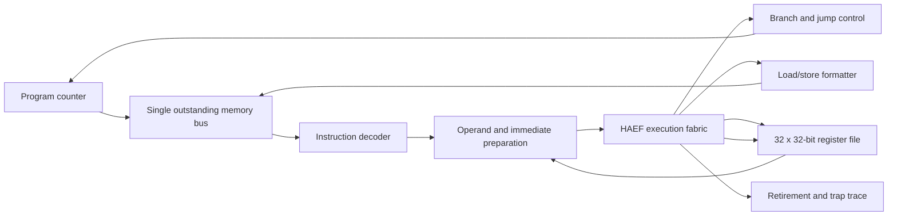

# Elyndra Helix H1

Elyndra Helix H1 is an experimental, independently developed 32-bit processor research platform. It implements an in-order RV32I integer core and a bounded comparison of three Helix Adaptive Execution Fabric (HAEF) configurations. The project makes no novelty, silicon, timing, area, power, or performance claim.

**Status:** RTL, verification sources, synthesis scripts, and cloud workflows are prepared locally. No HDL compilation or simulation has yet run; the evidence workflows must execute in GitHub Actions after publication. This is not a RISC-V compliance claim.

## Architecture

The core fetches one 32-bit instruction at a time and completes each instruction before fetching the next. Instruction fetches, loads, and stores share one valid/ready bus with one outstanding request. A bus error is reported by the environment through `mem_error`. Byte lanes use little-endian ordering and per-byte write strobes.



The diagram source is [`research/architecture.mmd`](research/architecture.mmd). The same diagram is used in the research protocol.

### RV32I behavior

The decoder and execution path cover the RV32I base integer instructions: `LUI`, `AUIPC`, `JAL`, `JALR`, all six conditional branches, five load forms, three store forms, the ten register ALU operations, the nine immediate ALU operations, and `FENCE`. `x0` always reads zero. `FENCE` is a no-op after older bus transactions complete because the core serializes requests. `FENCE.I`, CSR instructions, privileged instructions, and extensions such as M and C are unsupported and trap as illegal instructions.

`ECALL` and `EBREAK` raise visible architectural traps. Misaligned instruction targets, data accesses, and external bus errors also raise visible traps. The core records cause, faulting PC, and trap value, then halts; it has no privileged CSRs, trap vector, interrupt controller, or trap-return instruction. This behavior is documented and deliberately fail-closed.

### HAEF configurations

| Configuration | Implementation | Comparison question |
|---|---|---|
| A — Baseline | Conventional addition and subtraction paths with the serialized core | Reference structure for this repository |
| B — Shared execution | Shared add/subtract arithmetic in the execution ALU | What generic cell structure changes when arithmetic is shared? |
| C — Decoupled execution | Shared ALU plus a one-entry prepared-instruction buffer transferred to execution | What state and generic structure does this bounded buffer add? |

All variants use the same ISA behavior and bus contract. Configuration C holds one decoded instruction and its operands in a separate registered preparation buffer before transfer to execution. It does not overlap memory requests, issue multiple instructions, speculate, or reorder work. Throughput and performance are not inferred from these structural variants.

## Repository map

- `rtl/`: core, controller, decoder, ALU, register file, immediate generator, branch unit, memory formatter, execution fabric, and variant tops.
- `tests/`: Cocotb unit tests, an independent Python architectural interpreter, instruction encoders, and a processor-level RV32I smoke program.
- `programs/`: description of the reproducible program assembled by the test source.
- `scripts/`: cloud simulation, lint, synthesis, variant comparison, report, and static checks.
- `research/`: architecture, experimental protocol, methodology, and limitations.
- `research/tool-licenses.md`: external tool license review.
- `results/`: report conventions. Generated evidence is uploaded by CI; this checkout contains no fabricated result files.
- `.github/workflows/`: independent cloud simulation and synthesis workflows.

## Verification and evidence

Cocotb tests cover ALU operations with directed and seeded randomized inputs, branch predicates, immediate formats, decoder legality, register-file reset and `x0`, and processor-level instruction streams. The core tests compare every retired instruction and register result against an independent Python interpreter. They also exercise loads, stores, control flow, `FENCE`, illegal instructions, `ECALL`, `EBREAK`, misalignment, and instruction/data access faults.

The fixed random seed is `1212231729` by default and may be overridden with `HELIX_SEED`. Every generated simulation report records the seed, RTL SHA-256, tool versions, test names, status, logs, and JUnit XML paths. Failures include instruction, PC/input state, expected and actual values, and the test location.

No compile, simulation, synthesis, or benchmark result is present until a cloud workflow actually runs. The tests are verification sources, not evidence that they passed.

## Synthesis methodology

Yosys synthesizes each variant independently into generic cells, checks the resulting design, and writes machine-readable netlists and counts. Verilator lint and Yosys warnings are retained in the evidence artifacts. The comparison script refuses to compare different RTL source hashes.

Generic cell totals and sequential-cell counts are tool outputs for the current generic netlist. They are not physical area, timing closure, power, energy, silicon cost, or workload performance. No technology library, timing constraint, switching activity, PDK, or physical implementation is included.

## Cloud-only reproduction

The project policy is to run HDL compilation, simulation, and synthesis only in GitHub Actions. The local `make check` and `make diagrams` targets are static checks and do not invoke an HDL tool.

The toolchain is recorded in [`toolchain.lock.json`](toolchain.lock.json): Python 3.12.14, Cocotb 2.0.0, Verilator v5.036, and Yosys 0.69 from the pinned `yowasp-yosys` package. GitHub-hosted Ubuntu 24.04 runners provision the tools. The Verilator source tag is fixed; its reported version and each RTL hash are captured with the run.

After the GitHub repository is created and these files are pushed, the two workflows run on pushes and pull requests:

1. `simulation.yml` runs Python static validation and all Cocotb/Verilator suites.
2. `synthesis.yml` runs Verilator lint, Yosys synthesis for A/B/C, structural comparisons, and report generation.

Use `make check` for local static Python/configuration checks. Use the Actions page or `workflow_dispatch` to run resource-intensive HDL work in the cloud. `make simulation`, `make synthesis`, and `make benchmark` are intended for the cloud runner.

On a GitHub-hosted runner with the pinned dependencies installed:

```sh
make check
make diagrams
make simulation
make synthesis
make compare
make report
```

`make setup` installs the Python dependencies but does not install Verilator or run hardware tools. The workflows provide the complete cloud setup.

## Current limitations and research goals

This is a single-hart, single-issue, in-order baseline with no cache, MMU, interrupts, privileged architecture, compressed instructions, atomic operations, floating point, debug module, or bus protocol bridge. The external environment owns memory timing and address-map policy. Traps halt the core instead of entering a software handler. No independent RISC-V architectural certification suite has run.

The research goal is a reproducible structural comparison of the three HAEF configurations. Future work may add compliance tests, a standard bus adapter, a trap-handling subsystem, workload-level evaluation, and technology-aware physical design. Each extension requires a separately documented acceptance protocol. See [`research/limitations.md`](research/limitations.md).

## License

The project source is provided under the Apache License 2.0. See [`LICENSE`](LICENSE).
